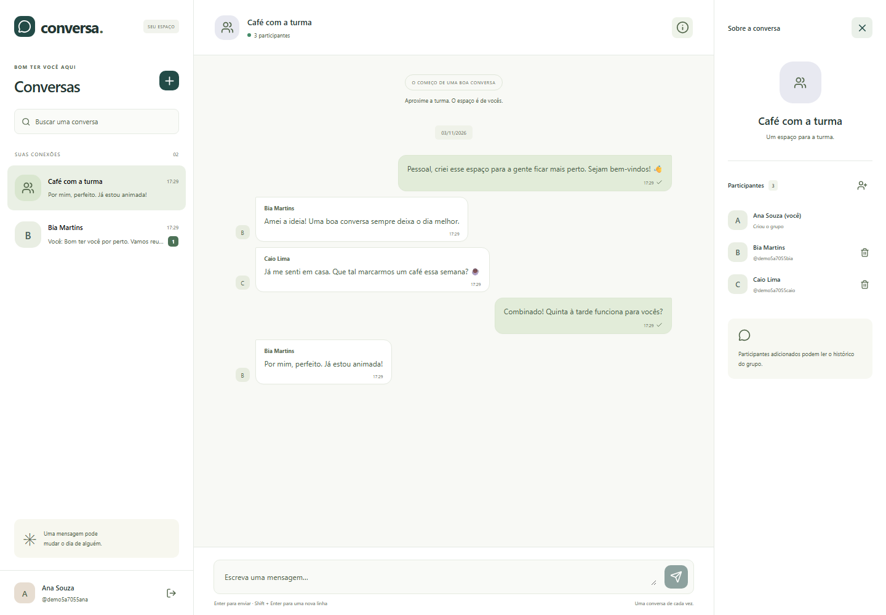
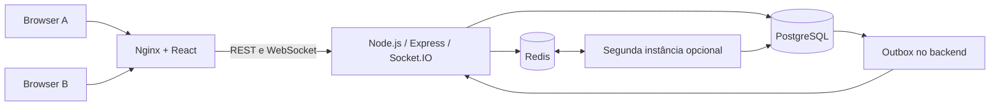

# Conversa · Realtime Chat Platform

Chat autoral com cadastro e login, conversas privadas, grupos e presença online. Frontend React e backend Node.js/TypeScript com Socket.IO, PostgreSQL e Redis. A interface e os dados usados nas imagens são próprios/fictícios.



## O que você pode fazer

- Criar uma conta com nome, usuário público, e-mail privado e senha; entrar e sair.
- Encontrar outras pessoas cadastradas, ver presença aproximada e iniciar uma conversa privada.
- Criar grupos com pelo menos três pessoas, adicionar/remover participantes como proprietário.
- Enviar mensagens em tempo real, ver indicação de digitação e contagem de mensagens não lidas.
- Reabrir a página e recuperar o histórico persistido; reenviar com o mesmo identificador sem duplicação.
- Usar várias abas: fechar uma não torna a pessoa offline se outra ainda estiver conectada.

O projeto é uma demonstração de engenharia para portfólio. Não depende de serviços pagos, domínio ou fornecedor de IA para funcionar localmente. Visitantes só acessam conversas das quais participam; o e-mail não aparece no diretório de pessoas.

## Começar localmente

Pré-requisitos: Git, Docker com Compose v2 e Node.js 24. Aproximadamente 2 GB livres para executar o stack; reserve mais memória para builds/testes. Linux containers devem estar habilitados no Docker Desktop.

```bash
git clone https://github.com/JeffeMartins/realtime-chat-platform.git
cd realtime-chat-platform
node scripts/setup.mjs
docker compose up --build -d --wait --wait-timeout 180
```

Abra **http://localhost:3100**, crie uma conta e use outra janela/perfil anônimo para cadastrar uma segunda pessoa. Clique no **+**, encontre o usuário e comece a conversa. Para testar grupo, crie uma terceira conta e selecione **Um grupo**. Não há contas padrão ou senha compartilhada embutida na aplicação.

O setup gera `.env` com senhas aleatórias para banco e Redis, sem sobrescrever arquivo existente. Esse arquivo fica fora do Git. Os dados são mantidos no volume `conversa-chat_chat-data`, isolado dos outros projetos da máquina. PostgreSQL/Redis não publicam portas no host.

| Recurso                  | Endereço                         |
| ------------------------ | -------------------------------- |
| Aplicação                | http://localhost:3100            |
| API local de diagnóstico | http://localhost:8100            |
| Liveness / readiness     | `/health/live` / `/health/ready` |
| Segunda API opcional     | http://localhost:8101            |

Para parar preservando usuários e mensagens:

```bash
docker compose down
```

`down -v` apaga os volumes e os dados. Alterar a senha do PostgreSQL no `.env` não modifica automaticamente um usuário em volume já inicializado; preserve o arquivo ou faça uma rotação deliberada.

## Arquitetura



Monólito modular, sem microserviços artificiais: autenticação, conversas, persistência e gateway em tempo real têm módulos próprios. `packages/contracts` compartilha schemas Zod e DTOs entre API e frontend. Frontend e API têm Dockerfiles/imagens independentes. PostgreSQL é a fonte de verdade; Redis coordena presença, limites e distribuição de eventos entre processos.

O transporte é **Socket.IO sobre WebSocket**, não WebSocket puro. O protocolo e o cliente Socket.IO são necessários; um cliente `new WebSocket()` isolado não interpreta os eventos da aplicação. Não há fallback para long polling nesta versão, evitando depender de sticky sessions no cenário multi-instância. O proxy precisa aceitar HTTP Upgrade.

Veja [decisões de arquitetura](docs/architecture.md), [contratos HTTP e eventos](docs/contracts.md), [operação](docs/operations.md), [hospedagem futura](docs/deployment.md) e [validação](docs/validation.md).

## Testar e desenvolver

```bash
npm ci
npm run build
npm run lint
npm run format:check
npm test
docker compose --profile scale-test up --build -d --wait --wait-timeout 180
npm run test:integration
npx playwright install chromium
npm run test:e2e
```

Em Linux limpo use `npx playwright install --with-deps chromium`. Testes de integração criam usuários sintéticos próprios e usam PostgreSQL, Redis e dois servidores reais; não precisam de acesso a dados de terceiros. Os testes de navegador usam sessões independentes. Relatórios e screenshots gerados ficam ignorados em `playwright-report`, `test-results` e `.artifacts`.

Para recarga do frontend: `npm run build -w @conversa/contracts` e `npm run dev -w @conversa/web`, após parar o container `web` que usa 3100; mantenha API/banco/cache em Docker. O Vite encaminha HTTP e sockets à API 8100. Evite trocar a origem sem ajustar `APP_ORIGIN`: a validação de origem é intencional.

## Segurança e escopo

Sessão opaca em cookie HttpOnly e SameSite=Lax; só o hash do token fica no banco. Origem explícita, CSRF de sessão em mutações/handshake, senha Argon2id e autorização por conversa são verificados no servidor. Logout revoga a sessão e desconecta seus sockets em todas as instâncias. A sessão expira após sete dias, inclusive com WebSocket aberto. Em origem HTTPS o cookie usa Secure.

Mensagens são tratadas como texto, sem HTML arbitrário. Consultas SQL parametrizadas, schemas estritos, limites de corpo/mensagem, rate limits Redis e limite de concorrência para hash de senha reduzem abuso. Containers API executam sem root e com filesystem somente leitura; as credenciais ficam no servidor. O frontend não recebe senha de banco ou token de sessão legível por JavaScript.

Ainda não há verificação de e-mail, recuperação de senha, anexos, chamadas, edição/exclusão de mensagens, bloqueio de usuários ou moderação. Não há criptografia ponta a ponta: o servidor e administradores do banco conseguem ler mensagens. HTTPS protege o transporte quando configurado no deploy. Estas limitações são relevantes antes de abrir uma instalação ao público.

O histórico de grupos fica disponível para novos participantes enquanto eles forem membros. Remover alguém revoga leituras e envios futuros; não retira cópias de mensagens já recebidas. A lista mostra as 50 conversas mais recentes, o diretório retorna até 30 pessoas por busca e o navegador mantém até 300 mensagens por conversa; o histórico HTTP é paginado e permanece no banco.

## Publicação futura

Não existe dependência de um domínio específico. Há um overlay opcional com Caddy/HTTPS para um servidor de testes; configurar DNS e hospedagem é uma etapa separada. O stack local não está automaticamente acessível pela internet. [Instruções](docs/deployment.md).

Licença MIT. Dados de demonstração e screenshots não representam conversas reais de terceiros.
